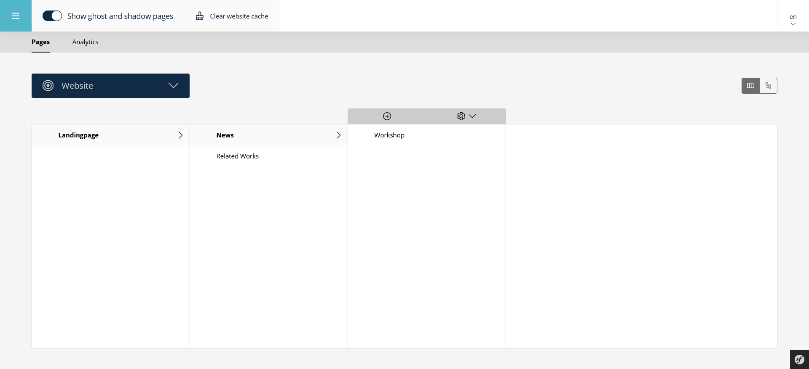
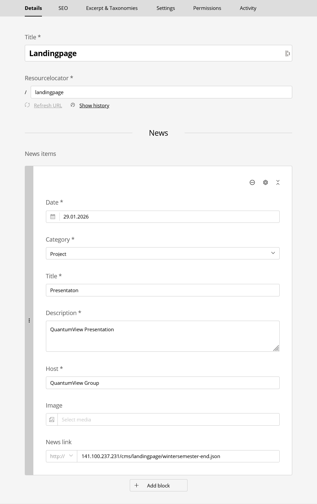
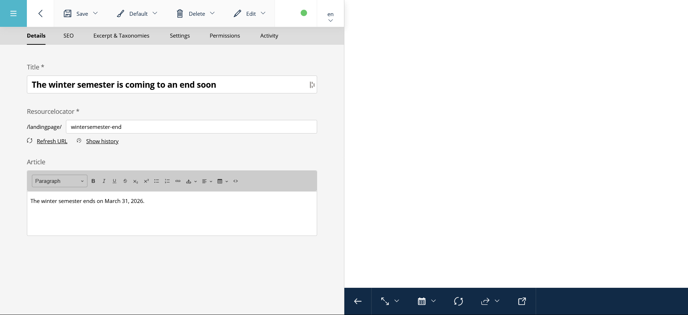

# Sulu CMS

Diese README beschreibt die Sulu-seitige Konfiguration der News in dieser Codebasis.

## Inhaltsverzeichnis
- [Seitenstruktur & Navigation im CMS](#seitenstruktur--navigation-im-cms)
- [News Block auf der Landingpage (CMS-Ansicht)](#news-block-auf-der-landingpage-cms-ansicht)
- [News Detailseite](#news-detailseite)

## Seitenstruktur & Navigation im CMS


Dieses Bild zeigt die Seitenhierarchie im Sulu CMS.

### Struktur
- Landingpage
    - News
        - Workshop (News-Detailseite)

Die News-Detailseiten sind Child-Pages der News. Sie sind nicht automatisch sichtbar, sondern werden über den `newsLink` referenziert.

## News Block auf der Landingpage (CMS-Ansicht)

Das Bild zeigt die Bearbeitungsansicht der Landingpage im Sulu-Admin mit dem konfigurierten News-Block.

### Relevante Punkte im CMS
Die Landingpage hat:
- **Title:** Landingpage
- **Resourcelocator:** /landingpage

In der Section News befindet sich der Block News items. Jeder Block-Eintrag entspricht einem News-Teaser auf der Landingpage

### Sichtbare Felder im News-Block
- `Date` (Pflichtfeld) → Veröffentlichungsdatum der News
- `Category` (Pflichtfeld, Single Select) → z. B. Project, Publication, Teaching
- `Title` (Pflichtfeld) → Überschrift des News-Teasers
- `Description` (Pflichtfeld) → Kurzbeschreibung für die News-Liste
- `Host` (Pflichtfeld) → Quelle oder Institution (z. B. QuantumView Group)
- `Image` (optional) → Vorschaubild für die News-Liste → Wird im Frontend noch nicht angezeigt
- `News Link` (optional) → URL zur News-Detailseite (Headless JSON) → Für Dev https verwenden und für Prod http verwenden

### Wichtige Einschränkungen
- Maximal **10** News-Items können hinzugefügt werden
- Das Feld `News Link` verweist nicht auf HTML, sondern auf eine JSON-Seite

## News Detailseite


Die Detailseite einer News basiert auf dem Default-Page-Template.

### Relevante Felder
- `Title` → Titel der News-Detailseite → Wird auch im JSON ausgeliefert
- `Resourcelocator` → z. B. /landingpage/news/workshop
- `Article` (text_editor) → Hauptinhalt der News → Beliebiger Rich-Text (Absätze, Links, etc.)

### Zusammenhang mit dem News-Block
Der News link im News-Block verweist auf:
```
/landingpage/news/workshop.json
```
Deutsch:
```
/de/landingpage/news/workshop.json
```

Beim Setzen des Feldes `News Link` ist darauf zu achten, dass die URL immer mit `/cms/` beginnt. Der Zugriff auf Sulu erfolgt in dieser Umgebung über einen Reverse Proxy. Nur Requests, deren Pfad mit `/cms/` beginnt, werden korrekt an das Sulu CMS weitergeleitet.

#### Korrekte Beispiele
```
http://141.100.237.231/cms/landingpage/news/workshop.json
```
Deutsch:
```
http://141.100.237.231/cms/de/landingpage/news/workshop.json
```
